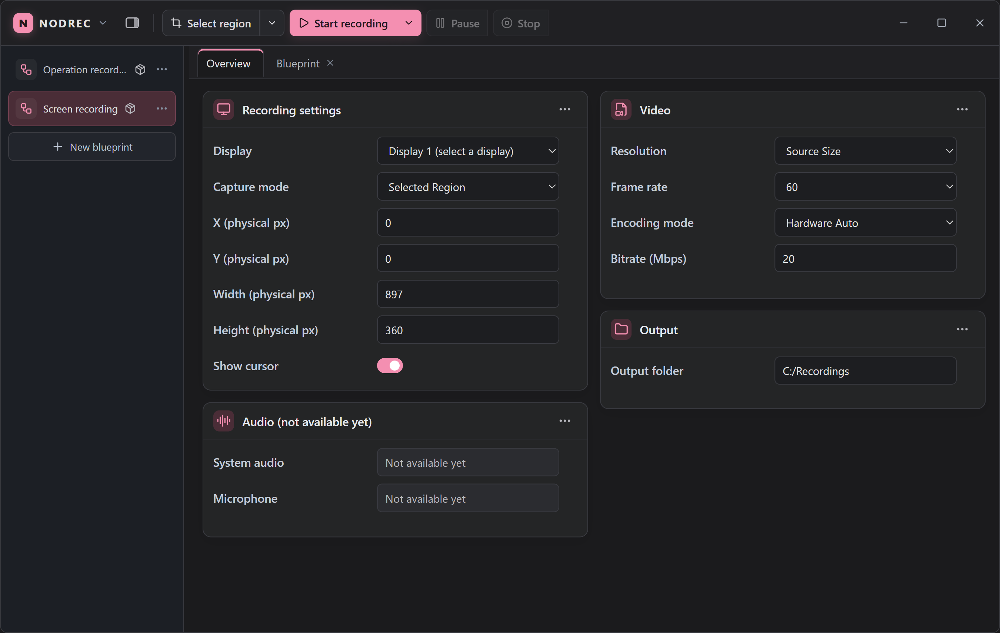

# Nodrec

Nodrec 是一个面向计算机操作的录制、回放与验证平台。它将简单预设和可编辑的节点工作流放在同一桌面应用中，并计划通过 MCP 向 AI Agent 提供相同的产品能力。

项目仍在开发中。当前版本面向 **Windows x64**，界面为英文；已经可以通过内置蓝图录制单个显示器的无声 H.264 MP4。键鼠录制、回放、像素比较与 MCP 仍在规划中。



## 目前可以做什么

| 能力 | 当前状态 |
| --- | --- |
| 屏幕录制 | 单显示器全屏或区域录制，支持鼠标显示、暂停／继续、帧率、分辨率、码率及硬件／软件 H.264 编码；输出 MP4 |
| 区域工具 | 框选并调整区域，使用蓝图注册的浮动录制控件；选区在当前蓝图会话中保留 |
| 蓝图编辑 | 在 Overview 修改参数，在节点画布编辑事件、连线及控制按钮；蓝图可保存、复制、删除和撤销删除 |
| 设置与更新 | Windows 安装器、网络代理设置与签名更新；更新前保存蓝图修改 |
| 尚未实现 | 音频、窗口捕获、键鼠记录／回放、像素差异报告、函数／子图执行及 MCP。Operation recording 目前只是不可运行的预览 |

录制采用 Windows Graphics Capture、D3D11 和 Media Foundation。硬件编码依赖设备支持，不会在失败时自动切换到软件编码。当前实录和设备限制见 [Capture](docs/modules/capture.md)、[Media Output](docs/modules/media-output.md) 和 [验收记录](docs/testing.md)。

## 安装与录制

1. 从 [GitHub Releases](https://github.com/JasonMa0012/Nodrec/releases) 下载最新 Windows 安装器并安装。
2. 打开 **Screen recording**，在 Overview 中选择显示器、Capture mode、视频规格和可写的输出目录。
3. 使用 Selected Region 时先点击 **Select region** 并框选；也可以选择全屏或手动区域。
4. 点击 **Start recording**，需要时暂停或继续，最后点击 **Stop** 等待 MP4 完成。

## 数据保存在哪里

- 蓝图是程序目录旁 `blueprints/builtin/` 或 `blueprints/user/` 中的 `.nodrec.json`；删除时移入 `.trash/`，本次运行期间可以撤销。
- 安装／更新会覆盖内置蓝图模板；如果修改了内置蓝图并希望在更新后保留，请先用 **Duplicate** 创建用户蓝图。普通启动不会补回已删除的模板。
- 应用设置保存在当前用户的 Tauri 配置目录。视频写入所选输出目录；录制未正常完成时可能保留 `.partial.mp4`。

详情见 [Storage](docs/modules/storage.md) 和 [数据与更新](docs/releases.md#安装和数据)。

## 从源码运行

需要 Windows x64、Node.js 24 和 npm、Rust stable MSVC 工具链、Visual Studio C++ Build Tools、Windows SDK 与 WebView2 Runtime。仓库根目录的启动脚本会在缺少 `node_modules` 时运行 `npm ci`，然后编译并启动 Tauri 开发版：

```bat
_Build_And_Run.bat
```

也可以在 PowerShell 中手动运行：

```powershell
cd apps/desktop
npm ci
npm run tauri:dev
```

只检查前端可运行 `npm run build`。`npm run tauri:build` 生成带更新签名的安装器，需要项目的私钥；本地未签名构建和正式发布的区别见 [发布与更新](docs/releases.md)。

## 验证

在 `apps/desktop` 下运行：

```powershell
npm run verify:unit  # lint、前端模型和 Rust 单元测试
npm run verify       # 加上签名 Release 构建及 Windows UI／实录回归
```

完整验证需要更新签名私钥、可见且正在刷新的 Windows 桌面和可用的 H.264 硬件编码器。单项测试、历史结果及尚未覆盖的设备场景见 [验收文档](docs/testing.md)；也可以运行 [tests](tests/README.md) 中的 Windows 脚本。

## 项目结构与文档

```text
apps/desktop/src/              React 界面、节点编辑器与前端模型
apps/desktop/src-tauri/src/    Tauri 命令、Rust 工作流、存储与 Windows 录屏
apps/desktop/blueprints/       内置蓝图模板
apps/desktop/scripts/          发布与自动化验证脚本
docs/                          规划、架构、接口、模块现状与验收记录
tests/                         常用验证命令的 Windows 入口
```

从 [知识库索引](docs/index.md) 进入项目文档；产品范围见 [总体规划](docs/project-plan.md)，当前架构见 [架构讨论](docs/architecture.md)，已确认选择见 [技术决策](docs/decisions.md)。开发约定见 [开发规则](docs/development.md) 和 [AGENTS.md](AGENTS.md)。
