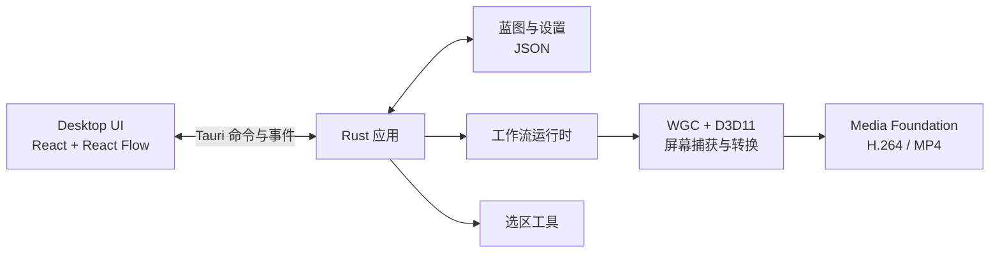

# 架构与验证路线

## 当前实现

桌面应用使用 React、TypeScript、React Flow 和 Tauri 2；Rust 负责蓝图存储、节点目录、运行时与 Windows 原生能力。

- Desktop 编辑蓝图、展示运行状态，并将事件派发给 Rust；Rust 校验节点和连线，执行事件链并解析媒体管线。
- 录制开始时冻结显示器、区域、视频规格和输出路径；原生录制线程处理图像与编码，逐帧数据不经过 WebView 或 Tauri IPC。
- 蓝图以单个 `.nodrec.json` 文件保存；应用设置与蓝图分开。格式、保存保护及目录见 [Storage](modules/storage.md)，模块间数据见 [接口文档](contracts.md)。
- Windows 捕获／编码的实现与设备限制见 [Capture](modules/capture.md) 和 [Media Output](modules/media-output.md)。当前不支持音频、窗口捕获、操作录制／回放或 MCP。

当前实现路线不等于所有平台和后续技术选择都已冻结。已确认选择按时间保存在 [技术决策](decisions.md)，各模块的真实状态以各自文档为准。

## 历史与待验证问题

2026-10-11 曾选择 Dear ImGui + imgui-node-editor 验证节点交互；2026-10-12 转向 React + Tauri。旧 IMGUI 原型源代码已于 2026-10-27 按用户要求从仓库移除，历史选择见 D001／D002；它的验证不代表当前产品能力。

后续仍需验证或选择：

- 窗口捕获、其他设备与平台的原生适配，以及实际游戏负载下的录制开销。
- 音频、输入与画面的同步，回放定位、验证基线和差异对齐。
- MCP 的传输、宿主与并发编辑方式，以及它与桌面 UI 的能力对等范围。
- 键盘、无障碍、多语言和不同 DPI 下的桌面体验。已知触摸板问题见 [排查记录](bugs/touchpad-axis-lock.md)。

需求、候选方案、已确认决策和实际验收结果应分别记录；验证只说明测试过的环境。
